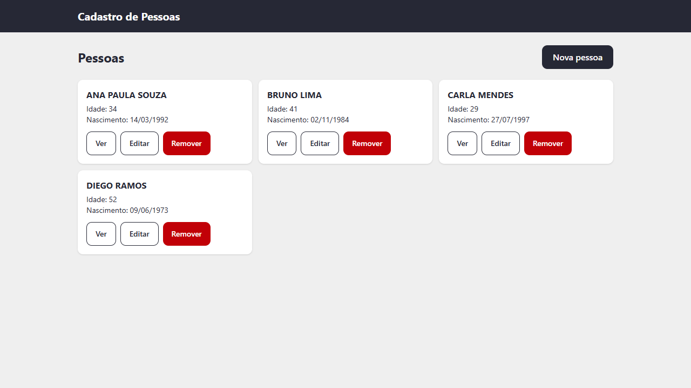
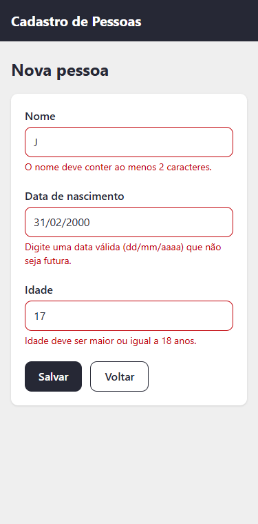

# CRUD-Cadastro

Cadastro de pessoas feito com **Angular 22**: criar, visualizar, editar e remover registros, com validações no formulário. **Os dados ficam no `localStorage` do navegador**: não há backend, então cada pessoa que abre o site vê apenas os próprios registros.

Acesse online: https://crud-cadastrodepessoas.netlify.app/

|                Lista                |                Formulário com validações (mobile)                |
| :---------------------------------: | :--------------------------------------------------------------: |
|  |  |

## Funcionalidades

- **Listar** as pessoas cadastradas, com estado vazio ("Nenhuma pessoa cadastrada.").
- **Cadastrar** e **editar** com o mesmo formulário.
- **Ver** os dados de uma pessoa em uma janela.
- **Remover** com confirmação em uma janela (sem `confirm()` do navegador).
- **Validações:** nome com pelo menos 2 caracteres; data de nascimento no formato `dd/mm/aaaa`, que exista e não seja futura; idade inteira, maior ou igual a 18.
- Rotas `pessoas/listas`, `pessoas/novo` e `pessoas/editar/:id`, título da aba por página e tela de página não encontrada.
- Edição de uma pessoa que não existe mostra uma mensagem com link de volta, em vez de quebrar a tela.
- Falha ao ler ou salvar no navegador (modo privado, armazenamento cheio, dados corrompidos) mostra um aviso claro.
- Registros salvos pela versão anterior do app continuam aparecendo e podem ser editados.

## Tecnologias

- Angular 22 (componentes standalone, signals, aplicação sem Zone.js, formulários reativos tipados)
- TypeScript 6 em modo estrito
- Tailwind CSS 4
- Vitest (testes), ESLint (`angular-eslint`) e Prettier
- GitHub Actions (formatação, lint, testes e build)

## Como rodar

Requer Node `^22.22.3`, `^24.15.0` ou `>=26`.

```bash
npm install
npm start          # http://localhost:4200
```

## Scripts

| Comando                | O que faz                                       |
| ---------------------- | ----------------------------------------------- |
| `npm start`            | Servidor de desenvolvimento                     |
| `npm run build`        | Build de produção em `dist/crud-pessoa/browser` |
| `npm test`             | Testes unitários (Vitest)                       |
| `npm run lint`         | ESLint                                          |
| `npm run format`       | Prettier (corrige)                              |
| `npm run format:check` | Prettier (somente verifica)                     |

Para rodar os testes uma vez, sem observar mudanças: `npm test -- --no-watch`.

## Estrutura

```text
src/app/
├── core/
│   ├── storage/     PessoaStorage (leitura e escrita no localStorage)
│   └── testing/     auxiliar de teste para o <dialog>
└── features/pessoas/
    ├── models/      Pessoa e regras (idade mínima)
    ├── state/       PessoasStore (signals)
    ├── utils/       máscara e validação da data de nascimento
    ├── components/  formulário e janela (dialog)
    └── pages/       lista, nova, editar e página não encontrada
```

## Decisões

- **Dados no navegador:** o projeto é uma demonstração de CRUD no front-end, sem servidor. A chave do `localStorage` continua `pessoas` e o formato antigo (idade e data como texto) é lido e convertido.
- **Data de nascimento:** é guardada só com os dígitos (`DDMMAAAA`), como o app sempre guardou; a máscara `dd/mm/aaaa` é aplicada na tela. A idade continua sendo um campo informado, separado da data.
- **Lista em cartões:** em vez de tabela, cada pessoa é um cartão, o que funciona em telas de 320 px sem rolagem horizontal.
- **Um formulário só:** cadastro e edição usam o mesmo componente.
- **Acessibilidade:** campos com rótulo, mensagens ligadas ao campo (`aria-describedby`), janelas nativas `<dialog>` (foco e Esc tratados pelo navegador), botões de ação com nome acessível e alvos de toque de 44 px.
- **Deploy:** o `netlify.toml` redireciona qualquer rota para o `index.html`, para que recarregar a página em `/pessoas/novo` não dê 404.
